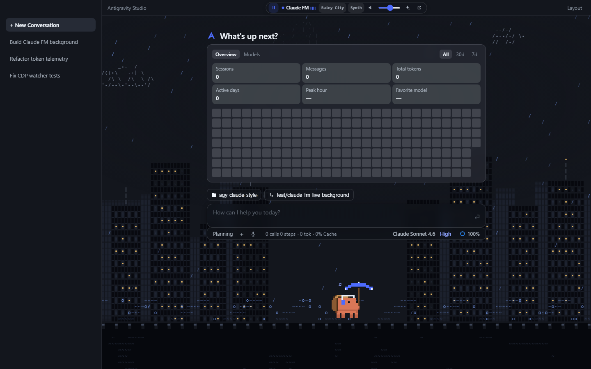
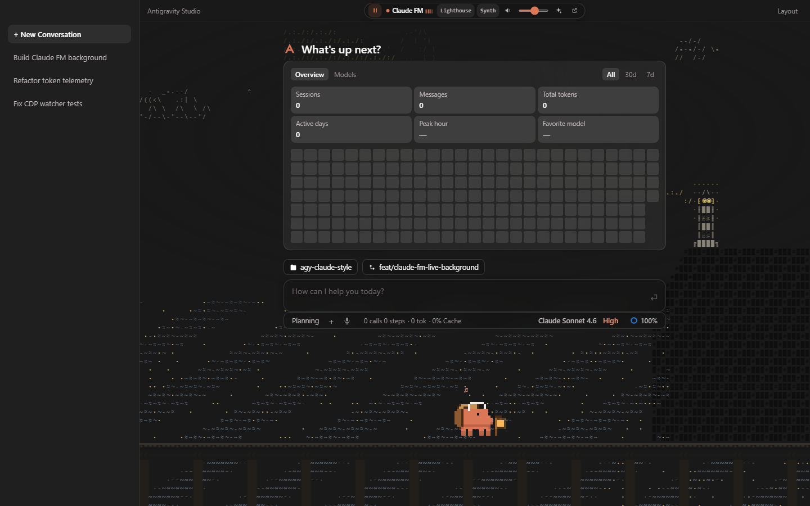

<div align="center">


# AGY Live Claude Style

**Live animated Claude FM 5-scene ASCII backgrounds, top-bar music player, and frosted UI for Google Antigravity.**

*A fork of [0DNANCY/agy-claude-style](https://github.com/0DNANCY/agy-claude-style) built for live ambient visuals across both Home and active conversations.*

[](https://github.com/0DNANCY/agy-claude-style)
[](#quick-start)
[](https://github.com/MattJPForrest201905/AGY-live-claude-style/releases)
[](LICENSE)

</div>

---

## Previews

| Rainy City (Dark · Obsidian) | Valley (Light · Claude Parchment) |
| --- | --- |
|  |  |

| Alpine Stars (Dark · Obsidian) | Ocean Lighthouse (Dark · Claude) |
| --- | --- |
|  |  |

<div align="center">

**Sakura Trail (Light · Claude Parchment)**


</div>

---

## What's Different from Upstream (`0DNANCY/agy-claude-style`)

Upstream provides the Claude Code aesthetic, Token HUD telemetry, effort sliders, 5-language i18n, perched Clawd mascot, and Home-only ASCII ripple field. **AGY Live Claude Style** extends it with:

| Area | Upstream (`0DNANCY/agy-claude-style`) | This Fork (`AGY-live-claude-style`) |
| --- | --- | --- |
| **Live Background** | Static-frame ripple matrix on `.agy-home` only | **5 full-bleed animated Claude FM scenes** (`valley`, `rainy-city`, `alpine-stars`, `ocean-lighthouse`, `sakura-trail`), 45s `auto` crossfades, optional muted **YouTube Live video** (`tRsQsTMvPNg`), or classic `ripple` |
| **Where It Renders** | Home view only (vanishes inside chats) | **Home & active/existing conversations** — seamlessly re-parents across `.agy-home`, `[data-testid="overview-panel-host"]`, and `[data-testid="conversation-view"]` with a soft chat readability veil and frosted composer cards |
| **Top-Bar Music Player** | None | **Centered `28px` titlebar pill** (`.ag-cs-fm-bar`) with play/pause, live equalizer, scene switcher, `YT` live audio / offline **Web Audio Lo-Fi `Synth`** toggle, mute + volume slider, animation pause/resume sparkle toggle, and external link |
| **OS Reduced-Motion Handling** | Follows OS `prefers-reduced-motion` (freezes canvas on Windows when enabled) | Canvas & top-bar equalizer stay animated by default; pause/resume anytime directly from the top-bar motion button |
| **Composer & Mascot Polish** | Perched mini-Clawd stays visible; long model + effort badges could clip (`Orchestrator...`) | Inline `[data-ag-cs-effort]` flow + tuned `@container input-footer` collapse ladder keeps long model names unclipped; hides duplicate mini-Clawd on Home during `claude-fm` mode |
| **Config & Native Watchers** | Base `config.json` keys | Adds `liveBackground`, `claudeFmScene`, `claudeFmBar`, `claudeFmSource`, and `claudeFmVolume` (`0–100`) with full persistence across Node, Windows C#, and macOS Swift watchers plus all 5 i18n locales |

### How It Works Under the Hood

1. **`claude-fm-core.js`**: Deterministic noise & ASCII/pixel renderer drawing drifting clouds, rain streaks, shooting stars, a leftward-sweeping lighthouse beam over a boardwalk pier, sakura petals + torii gate, interactive pointer wind gusts, a 22x14 pixel-art Clawd traveler (`hiking`, `umbrella`, `lantern`, plus music headphones & floating notes when audio is active), and a zero-dependency Web Audio Lo-Fi ambient synth fallback.
2. **`ui-runtime.js` + `style.css`**: Mounts `.ag-cs-claude-fm-host` behind Home or conversation panes via `resolveLiveBgHost()` / `insertLiveHostFirst()`, syncs 3-way merged settings via CDP `Runtime.addBinding`, and applies translucent `backdrop-filter` panels so UI chrome stays legible over the live scene.

---

## Quick Start

> Check [Releases](https://github.com/MattJPForrest201905/AGY-live-claude-style/releases) for prebuilt binaries, or run directly from source (Node.js >= 22):

```bash
git clone https://github.com/MattJPForrest201905/AGY-live-claude-style.git
cd AGY-live-claude-style

# Managed mode (launches/attaches Antigravity with --remote-debugging-port=0 and exits with host)
npm run managed

# Build standalone installers
npm run build:installer   # Windows .exe (requires .NET Framework 4.x csc.exe)
npm run build:macos       # macOS .app / .dmg (requires Xcode CLT swiftc)
```

---

## Configuration Example (`config.json`)

Copy [config.example.json](config.example.json) to `config.json` (or toggle options live in Antigravity `Settings -> Appearance` or the top bar):

```json
{
  "language": "en",
  "palette": "obsidian",
  "homeLayout": "studio",
  "liveBackground": "claude-fm",
  "claudeFmScene": "auto",
  "claudeFmBar": true,
  "claudeFmSource": "synth",
  "claudeFmVolume": 55,
  "ringMode": "quota",
  "effortSliderStyle": "claude"
}
```

- `liveBackground`: `"claude-fm"` (default) | `"youtube"` | `"ripple"` | `"off"`
- `claudeFmScene`: `"auto"` (45s cycle) | `"valley"` | `"rainy-city"` | `"alpine-stars"` | `"ocean-lighthouse"` | `"sakura-trail"`
- `claudeFmSource`: `"youtube"` (tRsQsTMvPNg) | `"synth"` (offline Web Audio ambient)

---

## Credits & License

- **Upstream Fork Base**: [0DNANCY/agy-claude-style](https://github.com/0DNANCY/agy-claude-style)
- **Original Inspiration**: [Nwflower/dsh-claude-style](https://github.com/Nwflower/dsh-claude-style)
- **Effort Sliders**: [Microqian2th/dsh-codex-effort-slider](https://github.com/Microqian2th/dsh-codex-effort-slider) · [mobius/dsh-performance-slider](https://github.com/mobius/dsh-performance-slider)

Licensed under the [MIT License](LICENSE).
